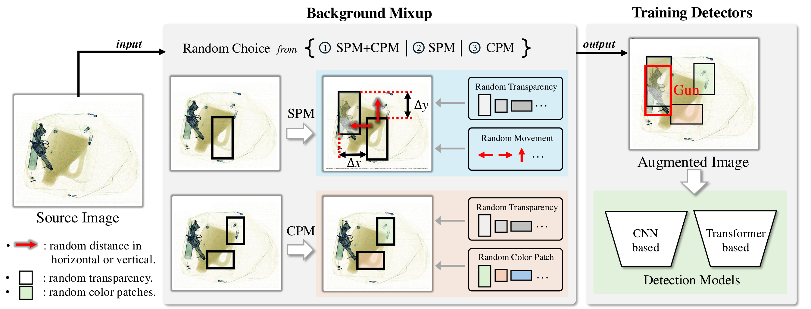

# [TIFS 2026] BGM: Background Mixup for X-Ray Prohibited Items Detection

[arXiv](https://arxiv.org/abs/2412.00460) | [IEEE TIFS](https://doi.org/10.1109/TIFS.2026.3734779) | [Hugging Face](https://huggingface.co/leowizard/background-mixup)

Implementation of BGM, Background Mixup for X-Ray Prohibited Items Detection.

[](assets/overview_v13.pdf)

## Checkpoints

Checkpoints are hosted at [leowizard/background-mixup](https://huggingface.co/leowizard/background-mixup) (private; authorized access required).

| Model | Dataset | Download |
| --- | --- | --- |
| Baseline | PIDray | [HF Hub](https://huggingface.co/leowizard/background-mixup/blob/main/output/mr_detr_align_r50_12ep/model_final.pth) |
| BGM | PIDray | [HF Hub](https://huggingface.co/leowizard/background-mixup/blob/main/output/mr_detr_align_r50_12ep_bgm/model_final.pth) |

Place each checkpoint as `model_final.pth` in `output/mr_detr_align_r50_12ep/` (Baseline) or `output/mr_detr_align_r50_12ep_bgm/` (BGM).

## Results

Recorded bbox AP on PIDray:

| Model | Positive | Easy | Hard | Hidden |
| --- | ---: | ---: | ---: | ---: |
| Baseline | 74.8 | 78.9 | 74.3 | 52.7 |
| BGM | **76.8** | **80.4** | **76.3** | **56.1** |

## Evaluation

Evaluate both checkpoints on Positive:

```bash
NUM_GPUS=1 CUDA_VISIBLE_DEVICES=0 bash run_test.sh
```

Evaluate both checkpoints on Easy, Hard and Hidden:

```bash
NUM_GPUS=1 CUDA_VISIBLE_DEVICES=0 bash run_test_occlusion.sh
```

## Citation

If you find this work useful, please consider citing:

```bibtex
@article{liu2026bgm,
  title={Bgm: Background mixup for x-ray prohibited items detection},
  author={Liu, Weizhe and Tao, Renshuai and Zhu, Hongguang and Sun, Yunda and Zhao, Yao and Wei, Yunchao},
  journal={IEEE Transactions on Information Forensics and Security},
  year={2026},
  publisher={IEEE}
}
```

## Acknowledgment

This implementation is based on Mr. DETR / detrex. We thank the authors for their contributions.
